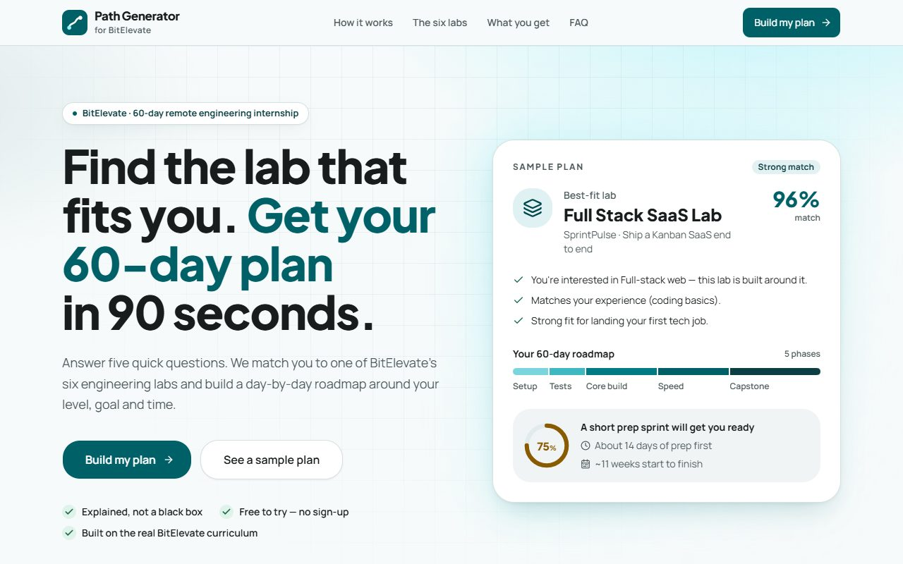
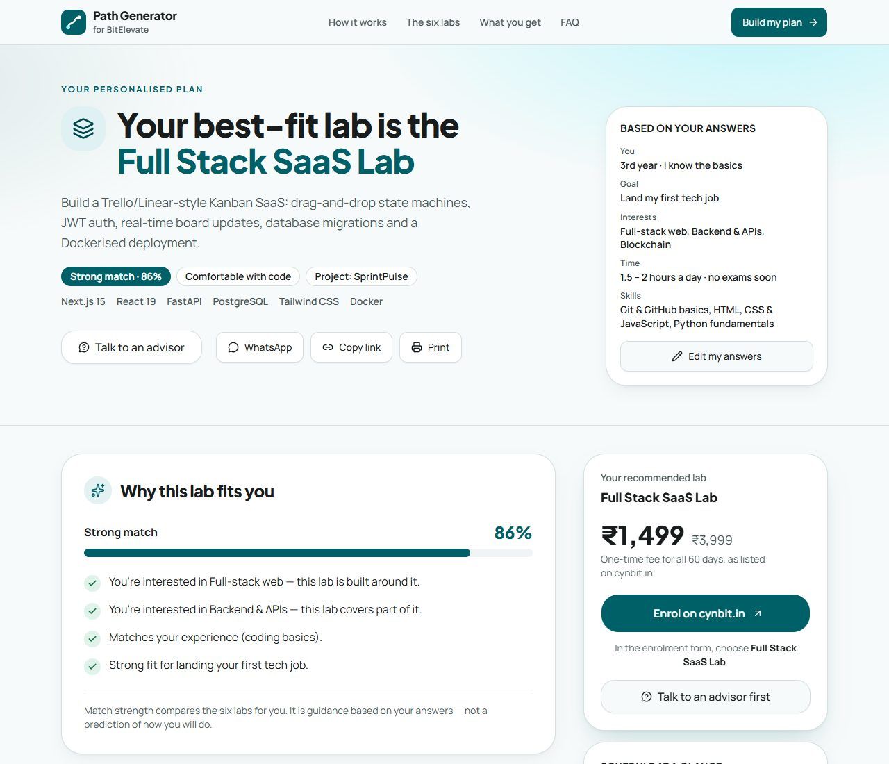
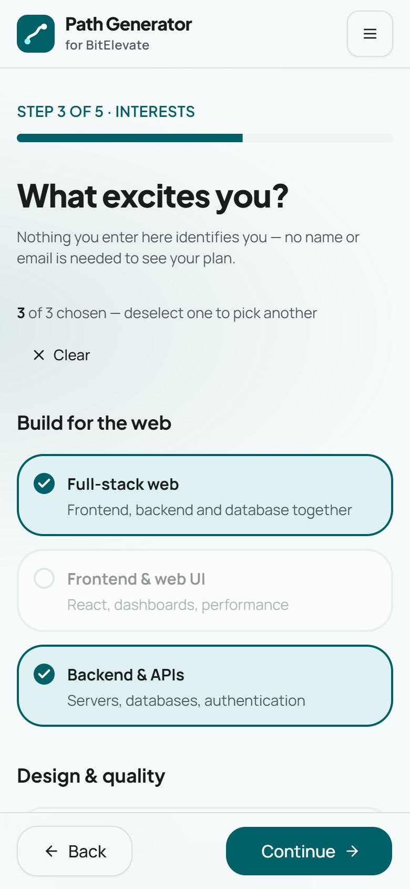
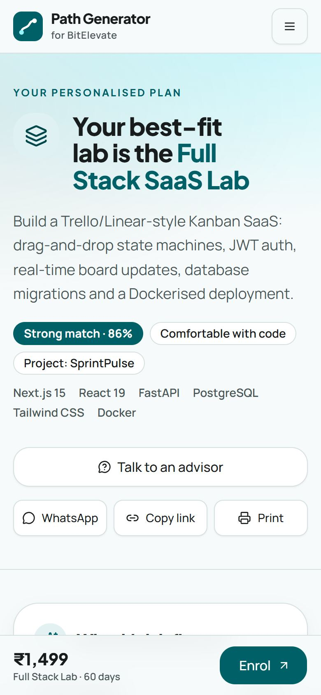
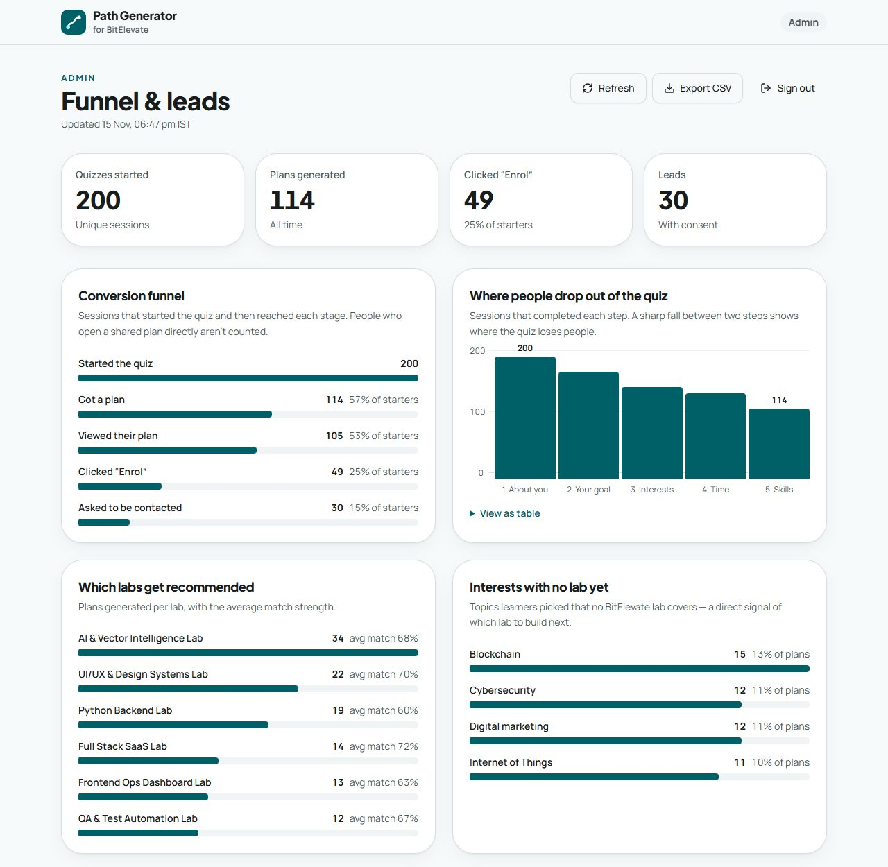

# BitElevate Path Generator

A working prototype of an **instant, explainable, personalised 60-day plan** for the BitElevate
internship — built as an improvement proposal for Cynbit Technologies.

**Stack:** MongoDB · Express · React · Node.js, with [shadcn/ui](https://ui.shadcn.com) on Tailwind CSS v4 (TypeScript throughout).

| | |
|---|---|
| Live demo | `<<add the deployed URL after deploying>>` |
| Source | this repository |
| Prototype status | Built for an assessment. Not an official Cynbit product. |

---

## The problem

On cynbit.in, `/bitelevate/paths` promises *"AI-driven customization"* and has a **Generate My Custom Path**
button. As of 15 November 2026 that button opens a form that collects a lead and tells the learner *"a senior
architect will reach out within 24 hours."* Nothing is generated, so:

- the learner gets no guidance at the moment of highest intent, and every lead costs human time;
- the site shows **three different track lists** (3 on the homepage, 6 labs on `/bitelevate`, 16 domains on
  `/bitelevate/paths`), and three of the six purchasable labs have no matching domain tile;
- the ₹1,499 price first appears about 73% of the way down the page (roughly eleven screens on a phone);
- there are no conversion events, so nobody can see where learners drop off.

## What this prototype does

1. **Five short questions** (about 90 seconds): where you are, your goal, interests, daily time, skills.
2. **An instant, explained plan** — no sign-up:
   - the best-fit lab **with the reasons**, runner-ups and *"choose it instead if…"*;
   - a readiness check, with the core skills to brush up (hours and a concrete task each);
   - your **60-day timeline** built from BitElevate's five real phases, showing what each phase looks like in
     *your* lab, plus tips tailored to you;
   - honesty about gaps: if you're interested in something no lab covers (blockchain, IoT…), it says so,
     suggests the closest lab and records the demand.
3. **Contact details only after value**, with explicit consent, a honeypot, and one-click *Delete my details*.
4. **Everything measurable**: anonymous funnel events, and an admin dashboard with a cohort funnel, quiz
   drop-off, lab distribution, and a ranked list of interests that have no lab yet.

## What it looks like

| Landing | Your plan |
|---|---|
|  |  |

| Quiz on a phone | Plan on a phone | Admin funnel |
|---|---|---|
|  |  |  |

## Architecture

```
shared/   TypeScript, framework-agnostic — used by BOTH sides
          engine · labs/phases/interests config · zod schemas · plan codec
client/    React 19 + Vite + shadcn/ui          server/   Express 5 + Mongoose (MongoDB)
  landing · wizard · plan · admin                 POST /api/plans        validate → engine → record analytics
  typed events → /api/events (+ optional GA4)     GET  /api/plans/:code  stateless (no DB read)
                                                  POST /api/leads        consent, honeypot, hashed delete token
                                                  POST /api/events       anonymous funnel events
                                                  /api/admin/*           JWT cookie auth, stats, CSV export
                                                  HTML shell: per-route OG tags, preloads, real 404s
```

Design choices worth knowing:

- **A plan is a pure function of the answers.** A share link therefore only needs to carry the answers,
  packed into ~40 URL-safe characters. Links need no database, contain no personal data, never expire, and
  keep working if storage is down. (`shared/src/codec.ts`)
- **One `shared` package** means the browser and the API cannot disagree about what a plan is.
- **Deterministic engine, no LLM.** It is instant, free, explainable, testable, and cannot invent facts about
  Cynbit's curriculum. Weights: interests 50%, goal 20%, level 20%, skills 10%. Interests no lab covers are
  reported separately and don't drag down the match for the rest.
- **All curriculum knowledge lives in config** (`shared/src/labs.ts`, `interests.ts`, `phases.ts`, `skills.ts`,
  `program.ts`) so Cynbit's mentors can review and correct it without touching logic. Items I inferred rather than
  read from the public site are marked `inferred` in the comments.

### API

| Method & path | Purpose |
|---|---|
| `POST /api/plans` | `{ answers, sessionId? }` → `{ code, plan }`. Validates, generates, records anonymous analytics |
| `GET /api/plans/:code` | Rebuilds a plan from a share code (404 for invalid/tampered codes) |
| `POST /api/leads` | Consented contact request (honeypot, rate-limited). Returns a one-time `deleteToken` |
| `DELETE /api/leads/:token` | "Delete my details" |
| `POST /api/events` | Anonymous client funnel events (server-truth events can't be forged) |
| `GET /api/config` | Which optional features (email) the server can honour |
| `POST /api/admin/login` · `logout` · `GET /me` | Admin session (HttpOnly, SameSite=Lax cookie) |
| `GET /api/admin/stats` · `/leads` · `/leads.csv` | Dashboard data and spreadsheet-safe CSV |

## Getting started

Requires Node 20+.

```bash
npm install
cp .env.example .env        # optional in development
npm run dev                 # API on :4000, client on :5173 (proxied)
```

With no `MONGODB_URI`, development starts a **throwaway in-memory MongoDB** so nothing needs installing.
The first run downloads a `mongod` binary (~600 MB, cached afterwards). To use your own database, set
`MONGODB_URI` (for example a free MongoDB Atlas cluster).

The development admin password is `admin` (change it with `ADMIN_PASSWORD`); open `/admin`.

### Scripts

| Command | What it does |
|---|---|
| `npm run dev` | API + client with hot reload |
| `npm run build` / `npm start` | Production build; serve API and built client from one Node process |
| `npm test` | Unit and API tests (shared engine, Express API against a real in-memory MongoDB) |
| `npm run e2e` | End-to-end and accessibility tests in real Chrome (run `npm run build` first) |
| `npm run lint` · `npm run typecheck` | ESLint · TypeScript across all workspaces |

### Environment

| Variable | Default / notes |
|---|---|
| `MONGODB_URI` | Required in production. Empty in development → in-memory MongoDB |
| `ADMIN_PASSWORD` · `ADMIN_JWT_SECRET` | Required in production (≥ 8 and ≥ 32 characters). The server refuses to start without them |
| `PUBLIC_URL` | Public base URL; used for absolute links in previews, sitemap and emails (never the `Host` header) |
| `PORT` · `TRUST_PROXY` | `4000` · `1` (number of reverse-proxy hops) |
| `RESEND_API_KEY` · `EMAIL_FROM` | Optional. Email of the plan is offered **only** if both and `PUBLIC_URL` are set |
| `VITE_GA_ID` · `VITE_ENROL_URL` | Optional GA4 id · where "Enrol" sends the learner |

### Deploying

It is one Node service: build, then start.

```bash
npm ci && npm run build        # build command
npm start                      # start command (NODE_ENV=production)
```

Set `MONGODB_URI`, `ADMIN_PASSWORD`, `ADMIN_JWT_SECRET` and `PUBLIC_URL` on the host. Serve over HTTPS (cookies
are `Secure` in production). Any host that runs Node works (Render, Railway, Fly.io, a VPS).

## Privacy and security

- Building a plan needs **no personal data**. Answers are stored only as an anonymous copy for product analytics.
- Contact details are collected **after** the plan is seen, with explicit consent; no date of birth, gender or address.
- Delete tokens are stored **hashed**; analytics events expire automatically after 180 days (MongoDB TTL index).
- Respects **Do Not Track** (nothing is sent). No cookies except the admin session.
- Express hardened with Helmet and a **strict CSP** (no `eval`, no third-party scripts unless GA is enabled),
  per-IP rate limits, 10 KB body limit, `sanitizeFilter` and zod validation on every body (operator injection is
  tested), honeypot, constant-time admin password check, JWT pinned to HS256 (`alg:none` forgeries tested).
- CSV export neutralises spreadsheet formula injection. Emails HTML-escape user input.

## Performance and accessibility

Measured with Lighthouse 13.6.0 on the production build, **mobile profile** (simulated slow 4G, 4× CPU
slowdown, Moto G Power emulation) — the same profile I used to audit cynbit.in on 15 Nov 2026.

| Page | Performance | Accessibility | Best practices | SEO | LCP | TBT | CLS |
|---|---|---|---|---|---|---|---|
| Landing `/` | **98** | 100 | 100 | 100 | 1.1 s | 180 ms | 0 |
| Wizard `/path` | **96** | 100 | 100 | 100 | 2.7 s | 62 ms | 0 |
| Plan `/plan/…` | **93** | 100 | 100 | 63¹ | 3.2 s | 45 ms | 0 |
| Privacy `/privacy` | **97** | 100 | 100 | 100 | 2.5 s | 43 ms | 0 |

¹ Intentional: shared plan links are `noindex` (they are for the people they're shared with, not search results).

For comparison, cynbit.in scored **35–68** on performance, with LCP of 9–11 s and up to 5.2 s of blocking
time on the same profile. The largest cause was a ~1.1 MB icon font; this prototype uses inline SVG icons,
self-hosted subset fonts and ~230–330 KB per page.

Honest caveats: these are single-machine lab numbers (Lighthouse's trace was flaky on localhost, so I kept
successful runs only — 1–2 per page — rather than a median of many); my app was measured on localhost while
cynbit.in was measured over the internet, which slightly favours mine; and the **plan page's LCP (3.2 s) is
still above Google's 2.5 s "good" threshold** — the remaining cost is loading the page's own route chunk.

What made the difference:

- icons are inline SVG (no icon font); fonts are self-hosted and the Latin subsets are **preloaded**;
- the server reads Vite's build manifest and **preloads each route's chunks** in `<head>`;
- the advisor form's libraries (react-hook-form, zod) load **on demand**, prefetched when the browser is idle;
- vendor code is split into long-lived cached chunks; nothing is hidden at `opacity: 0` while it animates in
  (a fully transparent hero would delay LCP), and `prefers-reduced-motion` is honoured.

Accessibility is checked with **axe-core against WCAG 2.2 AA** on every page and state in the end-to-end suite
(landing, each wizard state, plan, the advisor dialog and its error state, privacy, not-found, admin sign-in and
the dashboard). Real issues those checks caught and fixed during development: a logo link whose label didn't
contain its visible text (WCAG 2.5.3), a mobile-menu link that didn't scroll because Radix's focus return
cancelled the smooth scroll, and invalid ARIA on a chart. Keyboard use, skip link, focus management and
touch-target size (≥ 44 px) are covered by tests too.

## Testing

| Layer | Tests | What they cover |
|---|---|---|
| `shared` (Vitest) | 70 | data integrity (phases cover days 1–60, every lab reachable), golden learner profiles, invariants over 800 random learners, plan-code round-trips, rejection of malformed/tampered codes, and a 3,000-case fuzz test proving the hand-written decoder accepts only what the zod schema accepts |
| `server` (Vitest + Supertest, real in-memory MongoDB) | 125 | validation, NoSQL-injection attempts, consent and honeypot, hashed delete tokens, email honesty (never claims "sent" unless the provider accepted it), rate limits, admin auth attacks (`alg:none`, expired, wrong-secret tokens), cohort funnel maths, CSV formula-injection safety, link-preview tags, preload hints, real 404s |
| End-to-end (Playwright, real Chrome) | 36 | full learner journey, shared links, advisor request and data deletion, admin, keyboard-only quiz, reduced motion, CSP violations, mobile layout (no horizontal scroll, sticky CTA, 44 px targets, menu) and axe on every page |

```bash
npm test            # shared + server (needs no setup; uses an in-memory MongoDB)
npm run build && npm run e2e
```

231 automated tests, all passing at the time of writing.

## Analytics events

| Event | Sent by | When |
|---|---|---|
| `path_started` | browser | the wizard opens |
| `step_completed` `{step}` | browser | each step is completed |
| `plan_generated` `{lab,match,unmatched}` | **server** | a plan is created (truth for the funnel) |
| `plan_viewed` `{lab,match}` | browser | a plan is opened |
| `enrol_clicked` `{lab,match}` | browser | the learner follows the enrol link (UTM-tagged) |
| `lead_form_opened` · `plan_shared` · `plan_link_copied` · `plan_printed` | browser | engagement |
| `lead_submitted` `{lab,advisor,email}` | **server** | a consented lead is saved |

**Suggested experiment** (needs Cynbit's own baseline): split `/bitelevate/paths` 50/50 between the current form
and this flow for 2–3 weeks. Primary metric: enrolments per 100 unique visitors. Guardrail: total lead volume.
This prototype makes **no conversion-lift prediction**.

## Integrating into cynbit.in

cynbit.in is a Next.js app; this prototype is MERN (as requested), so it is **portable, not drop-in**:

1. Copy `shared/` — the engine, config and schemas are plain TypeScript.
2. Mount the wizard and plan components (React + shadcn/ui, which works inside Next.js) at `/bitelevate/paths`.
3. Turn the thin Express handlers (validate → engine → record) into Route Handlers or Server Actions.
4. Replace `saveLead()` with the existing `submitServiceLead` (`serviceType = "Custom Learning Path"`, attach the plan).
5. Make `/bitelevate` read `?lab=` so the enrolment form pre-selects the recommended lab.
6. Have mentors review `shared/src/labs.ts` and `interests.ts`.

## Assumptions and limitations

- Built from Cynbit's **public pages only** (15 Nov 2026). No access to its analytics, database or pricing rules.
- Lab prerequisites, per-phase focus and the interest → lab mapping are **my assumptions** (marked `inferred`);
  program facts (60 days, 1.5–2 h/day, 14-day exam freeze, ₹1,499) are read from the public page.
- Match strength compares labs *for the learner*; it is guidance, not a prediction of success.
- Rate limits are per instance (in memory); behind several instances use a shared store such as Redis.
- The admin funnel aggregates sessions in memory — fine for thousands of sessions; pre-aggregate beyond that.
- Single admin password; real roles are a next step. English only.
- The page is client-rendered (fast on the measured profile, but not server-rendered HTML for the body copy).

## How this was built

AI assistants (Claude Code) were used as a **coding and research assistant** under my direction — for
scaffolding, boilerplate, scripts and review.

## Repository layout

```
shared/   engine, config, schemas, plan codec (+ unit tests)
server/   Express app, Mongoose models, routes, SEO/preload, API tests
client/   React app, shadcn/ui components, pages
e2e/      Playwright end-to-end and accessibility tests
```
